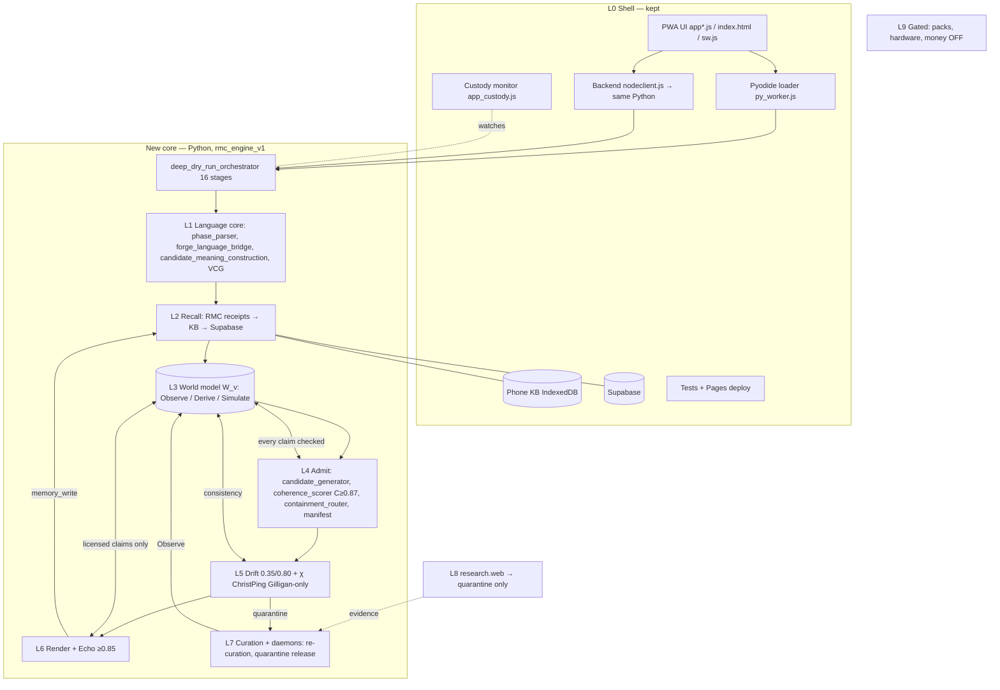

# REMODEL_PLAN — Forge Mobile clean core around rmc_engine_v1
Written 2026-10-29 CT. Plan only, no code changed. Inputs: ENGINE_LIST.md (259 rows), ENGINE_AUDIT.md (+Addenda 1–6), WORLD_MODEL_FINDINGS.md, Forge Mobile 4.9.173 source, gh/forge @ fcbf917.

## 0. Locked decisions (Nic, 2026-10-29) and laws
- **rmc_engine_v1 is canonical.** `deep_dry_run_orchestrator.run_deep_dry_run` is the spine. It runs in **Pyodide first**, with the **backend (nodeclient → same Python)** as a second runtime producing byte-identical traces.
- **No LLM, ever.** LLM-based functions (13 KEEP-AS-FUNCTION rows) are rebuilt on the language core.
- **C_min = 0.87, strict.** **Echo passes at similarity ≥ 0.85.** **Drift thresholds 0.35 (quarantine/χ) and 0.80 (hard stop)** are tunable starting points, measured and logged on every run.
- **Recall order:** RMC receipts → phone KB → Supabase.
- **research.web output = quarantined evidence only.** It never becomes an admitted world assertion without curation.
- **ChristPing/χ:** Gilligan-only, first-class stage.
- **Packs stay gated. Money stays disabled.**
- **Docs are the authority.** Where the docs conflict, the locked values above win.

## 1. Design principle: bounded drives (Omohundro)
| The system INCREASES | The system HOLDS FIXED |
|---|---|
| Coherence of admitted state (C ≥ 0.87 per admit) | The laws in §0 (no LLM, thresholds, recall order, gating) |
| Admitted knowledge in the world model (W_v grows only via Observe with evidence) | Means: no self-modification of code or laws, no new network targets, no money, packs gated, research quarantined |
| Help: answered, traceable questions; honest abstention otherwise | Correctability: every admit is reversible through quarantine → re-curation. History is append-only and never rewritten. Nic can always override. |

Resource-acquisition, self-preservation and goal-preservation drives are explicitly **not** goals. The engine has no objective over its own runtime, storage or permissions. Every admitted fact stays retractable.

## 2. Architecture

### Orchestrator stage → layer, with the world-model hook at each stage
| # | Stage (PIPELINE_ORDER) | Layer | World-model check |
|---|---|---|---|
| 1 | input_event | L1 | — |
| 2 | memory_recall_trace_spine | L2 | recall yields evidence refs; loads W_v version id |
| 3 | phase_parser | L1 | resolve entities/predicates against concept-sense + predicate-role registries |
| 4 | structural_drift_engine | L5 | drift vs W_v-consistent reading |
| 5 | protoforge2_drift_adapter | L5 | Simulate() branch when a claim is predictive |
| 6 | candidate_generator | L4 | candidates = Derive(W_v,R,Q) or unresolved |
| 7 | evolutionary_drift_explorer | L5 | branches are hypothetical, never committed |
| 8 | coherence_scorer | L4 | C includes contradiction with W_v; strict C ≥ 0.87 |
| 9 | containment_router | L4 | contradiction → quarantine |
| 10 | chi_correction_gate_preview | L5 χ | χ eligibility; Gilligan-only |
| 11 | storage_target_preview | L2 | receipt vs cold storage |
| 12 | resurrection_eligibility_preview | L7 | quarantine release requires re-curation |
| 13 | manifest_eligibility_check | L4 | manifest lists premises, rules, W_v version, epistemic status |
| 14 | output_renderer_eligibility_check | L6 | renderer may express only manifest-licensed claims |
| 15 | echo_validation_eligibility_check | L6 | Echo ≥ 0.85 vs selected meaning |
| 16 | memory_write_eligibility_check | L2/L3 | Observe(W_v,E) → W_v+1 only for admitted, evidenced claims |

Known gap: with no memory, the orchestrator routes `spc_cold_storage_required` and skips stages 14–16. Phase 183 fixes this by seeding receipts and KB, not by bypassing the routing.

## 3. Layers
- **L0 Shell (kept):** app.js, app_extra/lab/bench/account/custody.js, index.html, sw.js, styles.css, manifest.json, build.py, test/, verify/, tools/, Pages deploy, py_worker.js + pycheck.js (Pyodide loader, extended to mount the whole package), nodeclient.js (backend), sb_sync.js / sb_blobs.js / sync.js (Supabase), privacy.js, consent.js, e2ee.js, lifecycle.js, migrate.js, doctor.js, platform.js, sha256.js, legal_flags.js, drift_export.js, provenance.js / ledger.js / archives.js (custody records), sonify.js.
- **L1 Language core:** real Python from aiweb_language_core_bootstrap + rmc phase_parser + forge_language_bridge + forge2 contracts.
- **L2 Recall:** rmc memory_recaller/memory_writer + mea writers. Order: receipts → KB → Supabase.
- **L3 World model (new foundation):** WorldState/v1 per spec 1vBx §3 (Entity, Predicate, Assertion, Event, Quantity). Ontology from Doc 4 concept-sense registry; predicates from the Predicate–Role Frame Registry; epistemic status from mea claim_status/evidence_tier; quantities from gp quantity_ast/Pint; append-only history (FBSC capsules). API: Observe / Derive / Simulate. Storage: KB (IndexedDB) projection plus a Supabase mirror. Builds new from those docs only where no code exists (store, Observe/Derive/Simulate, branch isolation).
- **L4 Admit / coherence:** coherence_math (already real), candidate_generator, coherence_scorer, containment_router, gp governed pipeline, VCG gates, manifests.
- **L5 Drift + χ:** structural_drift_engine, protoforge2 drift adapter, ThermodynamicDriftAnalyzer, ChristPing.
- **L6 Render + Echo:** renderer + semantic_lexicon, outward_expression_runtime, echo validator.
- **L7 Curation / daemons:** quarantine, re-curation, dream/idle daemons (read-only over W_v).
- **L8 Research:** research.web/crawler. Output becomes evidence in quarantine only.
- **L9 Gated:** packs, hardware adapters (Brian2, PyBullet backend), economy/money (disabled).
- **PARKED:** aiweb stub engines. The spec is kept; they are not wired until Nic specifies behaviour.

## 4. Phased milestones
Every phase must pass the full existing test suite, add its own tests, ship to Pages, and log measured drift, C and Echo values per run.

| Phase | Scope | Done-criteria | Tests |
|---|---|---|---|
| **182: Pyodide mounts the real package** | Extend py_worker.js to load all 124 rmc_engine_v1 files + language core + forge2 contracts (wheel or zip). Mount the same package in the backend. No behaviour change in the UI yet. | `run_deep_dry_run("hello")` returns 16 stage records in browser and backend. Traces are hash-identical. | parity test browser vs backend; import-all smoke test; bundle size and load-time budget recorded |
| **183: Orchestrator becomes the Ask path; memory seeded** | Ask → orchestrator. RMC receipts + KB recall adapters (order locked). Seed receipts so stages 14–16 run. The JS kernel stays behind a flag only for A/B. | ≥90% of the sample set reaches stage 16 or a lawful abstain. Every answer has a full trace. | per-stage status test; recall-order test; cold-storage routing test |
| **184: World model v1 (L3)** | WorldState/v1 schemas, persistent store (KB + Supabase mirror), Observe/Derive, registries mounted as ontology/predicates, epistemic status from mea. Hook into stages 3, 6, 8, 13, 16. | Unseen names/relations accepted inside the grammar. Compositional answers never stored verbatim. Survives app restart. | T-WM-1 tank test (70 gal prediction; 65 gal observation recorded as discrepancy, prediction not rewritten); contradiction → quarantine; retraction keeps history; restart persistence |
| **185: Thresholds, χ, Echo locked in** | C_min 0.87 strict; Echo ≥ 0.85; drift 0.35/0.80 config with per-run measurement; χ Gilligan-only stage. | Threshold values read from one config. Every run logs C, drift, Echo. | boundary tests at 0.869/0.87, 0.849/0.85, 0.349/0.35, 0.799/0.80; χ-not-for-non-Gilligan test |
| **186: Delete JS stand-ins** | Remove the removal list (§5). JS flag removed. | grep finds no stand-in module referenced. UI works on the Python core only. | full suite; dead-import check; Pages smoke test |
| **187: KEEP-AS-FUNCTION rebuilds** | The 13 LLM-based functions (StoicClarifier, Journal, ToolManager/ResonanceMap, Co-Pilot, chroma_connector → KB vector-free recall, llm_renderer → renderer, …) rebuilt on the language core. | Each function has a no-LLM implementation and trace. Network audit shows zero model calls. | per-function golden tests; no-LLM network test |
| **188: Simulate + research quarantine** | Simulate() hypothetical branches (dynamics behaviour ported from dynamics.js tests). research.web → quarantine-only evidence. Re-curation flow. | Branches never write W_v. Web text never admitted without curation. | branch-isolation test; quarantine-escape test |
| **189: Live random-question acceptance** | Harness draws N=50 random questions (seeded, from SAMPLES.txt + adversarial rewordings + unseen-entity generator + off-grammar). Runs them through the live Pages app. | Per-question trace saved: stages 1–16 status, recall hits (source tier), W_v version, premises/rules, C, drift, χ, Echo score, answer or abstain reason. 0 hallucinated claims (claims not in manifest). Echo ≥ 0.85 on every answered question. | the live run itself, published as a trace report; repeated with a second seed |
| **190+ (gated)** | ProtoForge PyBullet backend for Simulate (backend only), packs, curation daemons. | Each one only on Nic approval. | per-feature |

## 5. Removal list (delete; do not patch)
JS stand-ins for engines that now run as real Python. Their behaviour is first captured as golden tests (phase 182–184), then the files are deleted in 186:
kernel.js (core logic; UI glue moves to app.js), forge.js, forge_spine.js, reason.js (JS TurnWorld), derive.js, grammar.js, qcompile.js, turn_packet.js, req_packet.js, msm.js, operator.js, governance.js, containment.js, render.js, echo_types.js, kmath.js, algebra.js, calculus.js, dynamics.js, infer.js, world_rules.js, lexicon.js, knowledge.js, gks.js, justify.js, hypothesis.js, transitions.js, evidence.js, claims.js, symbols.js, selfmodel.js (becomes W_v self-entity facts), evolve.js, ede.js, mea.js, mea_k.js, mea_p.js, mea_data.js, mea_k_data.js, mea_problems_data.js, stubs.js, sim.js, sim3d.js and protoforge.js (PREVIEW stand-ins).
**Review in 182, then decide:** dream_idle.js (1,204 lines; is it a curation daemon port or invention?), economy.js (money disabled; delete or gate), crawler.js (keep as L8 fetch shell, quarantined), toolbuilder.js / toolbench.js / tool_worker.js / fscript.js (gate under packs).
Also removed: every row in §6 marked "DELETE JS stand-in". That deletes the port only; the real source is mounted instead.

## 6. Every ENGINE_LIST row → layer and action (259 rows)
Generated by /tmp/rp/map.py from ENGINE_LIST.md. The rules are keyword- and role-based, so a row can land in the wrong layer. Review the placements in phase 182.
Totals per layer: L0 Shell: 1; L1 Language core (input): 22; L2 Recall: 12; L3 World model: 17; L4 Admit / coherence: 73; L5 Drift + χ: 20; L6 Render + Echo: 24; L7 Curation: 11; L7 Curation/daemons: 6; L8 Research (quarantined): 6; L9 Gated (packs/hardware): 4; PARKED (stub: spec kept, no code to wire): 63. Sum 259.

#### L0 Shell
| Row | ENGINE_LIST role | Status now | Action | Source |
|---|---|---|---|---|
| Codex integrity validator | other | MISSING | mount real Python | doc 1VYhjnaV |

#### L1 Language core (input)
| Row | ENGINE_LIST role | Status now | Action | Source |
|---|---|---|---|---|
| EchoForge StoicClarifier | input/parse | KEEP-AS-FUNCTION | rebuild function on language core (no LLM) | doc 17mlQZDe |
| candidate_meaning_construction | input/parse | MISSING | mount real Python | forge/aiweb_language_core_bootstrap/candidate_meaning_construction/ |
| forge2.canonical | input/parse | APPROXIMATED | DELETE JS stand-in; mount real source in Pyodide | forge2/src/forge2/contracts/canonical.py |
| forge2.capability_requirement | input/parse | APPROXIMATED | DELETE JS stand-in; mount real source in Pyodide | forge2/src/forge2/contracts/capability_requirement.py |
| forge2.classification_candidate | input/parse | APPROXIMATED | DELETE JS stand-in; mount real source in Pyodide | forge2/src/forge2/contracts/classification_candidate.py |
| forge2.codec | input/parse | MISSING | mount real Python | forge2/src/forge2/contracts/codec.py |
| forge2.context_manifest | input/parse | APPROXIMATED | DELETE JS stand-in; mount real source in Pyodide | forge2/src/forge2/contracts/context_manifest.py |
| forge2.frozen_value | input/parse | MISSING | mount real Python | forge2/src/forge2/contracts/frozen_value.py |
| forge2.identity | input/parse | APPROXIMATED | DELETE JS stand-in; mount real source in Pyodide | forge2/src/forge2/contracts/identity.py |
| forge2.input_event | input/parse | APPROXIMATED | DELETE JS stand-in; mount real source in Pyodide | forge2/src/forge2/contracts/input_event.py |
| forge2.request_contract | input/parse | APPROXIMATED | DELETE JS stand-in; mount real source in Pyodide | forge2/src/forge2/contracts/request_contract.py |
| forge2.request_state | input/parse | APPROXIMATED | DELETE JS stand-in; mount real source in Pyodide | forge2/src/forge2/contracts/request_state.py |
| forge2.successor | input/parse | APPROXIMATED | DELETE JS stand-in; mount real source in Pyodide | forge2/src/forge2/contracts/successor.py |
| forge_language_bridge v1–v5 | input/parse | APPROXIMATED | DELETE JS stand-in; mount real source in Pyodide | forge/forge_language_bridge_v1…v5/ |
| gp.source_compiler | input/parse | MISSING | mount real Python | forge/rmc_engine_v1/general_pipeline/source_compiler.py |
| gp.symbolic_math_ast | input/parse | MISSING | mount real Python | forge/rmc_engine_v1/general_pipeline/symbolic_math_ast.py |
| gp.symbolic_math_language_compiler | input/parse | MISSING | mount real Python | forge/rmc_engine_v1/general_pipeline/symbolic_math_language_compiler.p |
| gp.typed_ast | input/parse | MISSING | mount real Python | forge/rmc_engine_v1/general_pipeline/typed_ast.py |
| mea.fbsc_operator_crosswalk | input/parse | MISSING | mount real Python | forge/rmc_engine_v1/mea/fbsc_operator_crosswalk.py |
| outward_expression_runtime | input/parse | MISSING | mount real Python | forge/aiweb_language_core_bootstrap/outward_expression_runtime/ |
| phase_codex | input/parse | APPROXIMATED | DELETE JS stand-in; mount real source in Pyodide | forge/rmc_engine_v1/phase_codex.py |
| phase_parser | input/parse | MISSING | mount real Python | forge/rmc_engine_v1/phase_parser.py |

#### L2 Recall
| Row | ENGINE_LIST role | Status now | Action | Source |
|---|---|---|---|---|
| Assistant Roadmap recall | recall/memory | KEEP-AS-FUNCTION | rebuild function on language core (no LLM) | doc 1sSdpk8b |
| EchoForge Journal | recall/memory | KEEP-AS-FUNCTION | rebuild function on language core (no LLM) | doc 10zvT1_F |
| Proto system | recall/memory | KEEP-AS-FUNCTION | rebuild function on language core (no LLM) | doc 1Yhi-Yvf |
| active_loop_state | recall/memory | MISSING | mount real Python | forge/rmc_engine_v1/active_loop_state.py |
| chroma_connector | recall/memory | KEEP-AS-FUNCTION | rebuild function on language core (no LLM) | forge/rmc_engine_v1/chroma_connector.py |
| mea.controlled_manifest_memory_writer | recall/memory | APPROXIMATED | DELETE JS stand-in; mount real source in Pyodide | forge/rmc_engine_v1/mea/controlled_manifest_memory_writer.py |
| mea.live_candidates | recall/memory | MISSING | mount real Python | forge/rmc_engine_v1/mea/live_candidates.py |
| mea.live_term_binding | recall/memory | MISSING | mount real Python | forge/rmc_engine_v1/mea/live_term_binding.py |
| mea.manifest_memory_writer | recall/memory | MISSING | mount real Python | forge/rmc_engine_v1/mea/manifest_memory_writer.py |
| mea.seal_transaction_commit | recall/memory | MISSING | mount real Python | forge/rmc_engine_v1/mea/seal_transaction_commit.py |
| memory_recaller | recall/memory | APPROXIMATED | DELETE JS stand-in; mount real source in Pyodide | forge/rmc_engine_v1/memory_recaller.py |
| memory_writer | recall/memory | APPROXIMATED | DELETE JS stand-in; mount real source in Pyodide | forge/rmc_engine_v1/memory_writer.py |

#### L3 World model
| Row | ENGINE_LIST role | Status now | Action | Source |
|---|---|---|---|---|
| Lattice Admission | admit/coherence | MISSING | doc-only: implement from doc in its phase | doc 1A-yGMF_ §6.13.2/§6.13.7 |
| Phase-transition admit | admit/coherence | MISSING | doc-only: implement from doc in its phase | doc 1A-yGMF_ §2.3.1–2.3.2 |
| gp.domains_wordproblems | other | MISSING | mount real Python | forge/rmc_engine_v1/general_pipeline/domains_wordproblems.py |
| gp.gp003_word_problems | other | MISSING | mount real Python | forge/rmc_engine_v1/general_pipeline/gp003_word_problems.py |
| gp.gp011b_pint_quantity_integration | other | MISSING | mount real Python | forge/rmc_engine_v1/general_pipeline/gp011b_pint_quantity_integration. |
| gp.quantity_adapters | other | MISSING | mount real Python | forge/rmc_engine_v1/general_pipeline/quantity_adapters.py |
| gp.quantity_ast | input/parse | MISSING | mount real Python | forge/rmc_engine_v1/general_pipeline/quantity_ast.py |
| gp.quantity_runtime_attestation_gp011b | other | MISSING | mount real Python | forge/rmc_engine_v1/general_pipeline/quantity_runtime_attestation_gp01 |
| lexicon_audit | input/parse | MISSING | mount real Python | forge/rmc_engine_v1/lexicon_audit.py |
| mea.claim_status_classifier | admit/coherence | APPROXIMATED | DELETE JS stand-in; mount real source in Pyodide | forge/rmc_engine_v1/mea/claim_status_classifier.py |
| mea.evidence_tier_contract | admit/coherence | APPROXIMATED | DELETE JS stand-in; mount real source in Pyodide | forge/rmc_engine_v1/mea/evidence_tier_contract.py |
| mea.fixed_point_math_contract | other | APPROXIMATED | DELETE JS stand-in; mount real source in Pyodide | forge/rmc_engine_v1/mea/fixed_point_math_contract.py |
| mea.problem_manifest_store | recall/memory | MISSING | mount real Python | forge/rmc_engine_v1/mea/problem_manifest_store.py |
| meaning_structure_manifest | input/parse | APPROXIMATED | DELETE JS stand-in; mount real source in Pyodide | forge/aiweb_language_core_bootstrap/meaning_structure_manifest/ |
| predicate_role_frame_registry | input/parse | MISSING | mount real Python | forge/aiweb_language_core_bootstrap/predicate_role_frame_registry/ |
| resonance_lexicon | input/parse | APPROXIMATED | DELETE JS stand-in; mount real source in Pyodide | forge/rmc_engine_v1/resonance_lexicon.py |
| symbolic_grammar_operator_registry | input/parse | MISSING | mount real Python | forge/aiweb_language_core_bootstrap/symbolic_grammar_operator_registry |

#### L4 Admit / coherence
| Row | ENGINE_LIST role | Status now | Action | Source |
|---|---|---|---|---|
| Coherence Integrity Test | admit/coherence | MISSING | doc-only: implement from doc in its phase | doc 1DuEHogN |
| Phase-skip enforcement | admit/coherence | MISSING | doc-only: implement from doc in its phase | doc 1r9w4jJ5 |
| Verbal Cognition Gate (spec) | admit/coherence | APPROXIMATED | DELETE JS stand-in; mount real source in Pyodide | doc 15U_k-8w §1.4–3 |
| __init__ | other | MISSING | mount real Python | forge/rmc_engine_v1/__init__.py |
| candidate_generator | admit/coherence | MISSING | mount real Python | forge/rmc_engine_v1/candidate_generator.py |
| christping_adjudicator | admit/coherence | MISSING | doc-only: implement from doc in its phase | doc Codex docs |
| coherence_math | admit/coherence | RUNNING-REAL | keep (already real) | forge/rmc_engine_v1/coherence_math.py |
| deep_dry_run_orchestrator | other | MISSING | mount real Python | forge/rmc_engine_v1/deep_dry_run_orchestrator.py |
| deep_pipeline_preflight | other | MISSING | mount real Python | forge/rmc_engine_v1/deep_pipeline_preflight.py |
| evolutionary_drift_explorer | admit/coherence | APPROXIMATED | DELETE JS stand-in; mount real source in Pyodide | forge/rmc_engine_v1/evolutionary_drift_explorer.py |
| frozen_legacy_boundary | other | MISSING | mount real Python | forge/rmc_engine_v1/frozen_legacy_boundary.py |
| gp.__init__ | other | MISSING | mount real Python | forge/rmc_engine_v1/general_pipeline/__init__.py |
| gp.capability_registry | other | MISSING | mount real Python | forge/rmc_engine_v1/general_pipeline/capability_registry.py |
| gp.capability_services | other | MISSING | mount real Python | forge/rmc_engine_v1/general_pipeline/capability_services.py |
| gp.contracts | other | MISSING | mount real Python | forge/rmc_engine_v1/general_pipeline/contracts.py |
| gp.dependency_registry | other | MISSING | mount real Python | forge/rmc_engine_v1/general_pipeline/dependency_registry.py |
| gp.domains | other | MISSING | mount real Python | forge/rmc_engine_v1/general_pipeline/domains.py |
| gp.domains_equations | other | MISSING | mount real Python | forge/rmc_engine_v1/general_pipeline/domains_equations.py |
| gp.governed_gate | admit/coherence | MISSING | mount real Python | forge/rmc_engine_v1/general_pipeline/governed_gate.py |
| gp.gp002_linear_equations | other | MISSING | mount real Python | forge/rmc_engine_v1/general_pipeline/gp002_linear_equations.py |
| gp.gp004_production_reground | other | MISSING | mount real Python | forge/rmc_engine_v1/general_pipeline/gp004_production_reground.py |
| gp.gp005_capability_services | other | MISSING | mount real Python | forge/rmc_engine_v1/general_pipeline/gp005_capability_services.py |
| gp.gp006_dependency_license_registry | other | MISSING | mount real Python | forge/rmc_engine_v1/general_pipeline/gp006_dependency_license_registry |
| gp.gp007_strict_typed_ast | other | MISSING | mount real Python | forge/rmc_engine_v1/general_pipeline/gp007_strict_typed_ast.py |
| gp.gp008_manifest_contract_v2 | other | MISSING | mount real Python | forge/rmc_engine_v1/general_pipeline/gp008_manifest_contract_v2.py |
| gp.gp009_outcome_closure | other | MISSING | mount real Python | forge/rmc_engine_v1/general_pipeline/gp009_outcome_closure.py |
| gp.gp010b_audited_tool_activation | other | MISSING | mount real Python | forge/rmc_engine_v1/general_pipeline/gp010b_audited_tool_activation.py |
| gp.gp010c_runtime_truth_reconciliation | other | MISSING | mount real Python | forge/rmc_engine_v1/general_pipeline/gp010c_runtime_truth_reconciliati |
| gp.gp012r1_symbolic_math_computation_capability | other | MISSING | mount real Python | forge/rmc_engine_v1/general_pipeline/gp012r1_symbolic_math_computation |
| gp.gp013_natural_language_symbolic_math_vertical_slice | other | MISSING | mount real Python | forge/rmc_engine_v1/general_pipeline/gp013_natural_language_symbolic_m |
| gp.gp015_ask_forge_trace_surface | other | APPROXIMATED | DELETE JS stand-in; mount real source in Pyodide | forge/rmc_engine_v1/general_pipeline/gp015_ask_forge_trace_surface.py |
| gp.manifest_builder | other | MISSING | mount real Python | forge/rmc_engine_v1/general_pipeline/manifest_builder.py |
| gp.manifest_contract_v2 | other | MISSING | mount real Python | forge/rmc_engine_v1/general_pipeline/manifest_contract_v2.py |
| gp.outcome_contract_v2 | other | MISSING | mount real Python | forge/rmc_engine_v1/general_pipeline/outcome_contract_v2.py |
| gp.pipeline | other | MISSING | mount real Python | forge/rmc_engine_v1/general_pipeline/pipeline.py |
| gp.runtime_truth_attestation_gp010c | other | MISSING | mount real Python | forge/rmc_engine_v1/general_pipeline/runtime_truth_attestation_gp010c. |
| gp.safe_solver_adapters | other | APPROXIMATED | DELETE JS stand-in; mount real source in Pyodide | forge/rmc_engine_v1/general_pipeline/safe_solver_adapters.py |
| gp.symbolic_math_kernel | other | APPROXIMATED | DELETE JS stand-in; mount real source in Pyodide | forge/rmc_engine_v1/general_pipeline/symbolic_math_kernel.py |
| gp.symbolic_math_language_vertical_slice | other | MISSING | mount real Python | forge/rmc_engine_v1/general_pipeline/symbolic_math_language_vertical_s |
| gp.symbolic_math_mea_evidence_bridge | other | MISSING | mount real Python | forge/rmc_engine_v1/general_pipeline/symbolic_math_mea_evidence_bridge |
| gp.symbolic_math_rmc_delivery | other | MISSING | mount real Python | forge/rmc_engine_v1/general_pipeline/symbolic_math_rmc_delivery.py |
| gp.symbolic_math_runtime_attestation_math001r1 | other | MISSING | mount real Python | forge/rmc_engine_v1/general_pipeline/symbolic_math_runtime_attestation |
| gp.symbolic_math_worker | other | APPROXIMATED | DELETE JS stand-in; mount real source in Pyodide | forge/rmc_engine_v1/general_pipeline/symbolic_math_worker.py |
| mea.__init__ | other | APPROXIMATED | DELETE JS stand-in; mount real source in Pyodide | forge/rmc_engine_v1/mea/__init__.py |
| mea.api_preview | other | MISSING | mount real Python | forge/rmc_engine_v1/mea/api_preview.py |
| mea.candidate_generator | admit/coherence | APPROXIMATED | DELETE JS stand-in; mount real source in Pyodide | forge/rmc_engine_v1/mea/candidate_generator.py |
| mea.candidate_set_gate | admit/coherence | APPROXIMATED | DELETE JS stand-in; mount real source in Pyodide | forge/rmc_engine_v1/mea/candidate_set_gate.py |
| mea.coherence_extension | admit/coherence | APPROXIMATED | DELETE JS stand-in; mount real source in Pyodide | forge/rmc_engine_v1/mea/coherence_extension.py |
| mea.convergence_scorer | admit/coherence | APPROXIMATED | DELETE JS stand-in; mount real source in Pyodide | forge/rmc_engine_v1/mea/convergence_scorer.py |
| mea.gate_engine | admit/coherence | APPROXIMATED | DELETE JS stand-in; mount real source in Pyodide | forge/rmc_engine_v1/mea/gate_engine.py |
| mea.goal_ancestry_scorer | admit/coherence | APPROXIMATED | DELETE JS stand-in; mount real source in Pyodide | forge/rmc_engine_v1/mea/goal_ancestry_scorer.py |
| mea.hard_gate_report | admit/coherence | APPROXIMATED | DELETE JS stand-in; mount real source in Pyodide | forge/rmc_engine_v1/mea/hard_gate_report.py |
| mea.information_gain_scorer | admit/coherence | APPROXIMATED | DELETE JS stand-in; mount real source in Pyodide | forge/rmc_engine_v1/mea/information_gain_scorer.py |
| mea.manifest_advance_preview | admit/coherence | MISSING | mount real Python | forge/rmc_engine_v1/mea/manifest_advance_preview.py |
| mea.manifest_schema | admit/coherence | APPROXIMATED | DELETE JS stand-in; mount real source in Pyodide | forge/rmc_engine_v1/mea/manifest_schema.py |
| mea.math_conformance | other | MISSING | mount real Python | forge/rmc_engine_v1/mea/math_conformance.py |
| mea.measured_seal_gate | admit/coherence | APPROXIMATED | DELETE JS stand-in; mount real source in Pyodide | forge/rmc_engine_v1/mea/measured_seal_gate.py |
| mea.operator_cost_scorer | admit/coherence | APPROXIMATED | DELETE JS stand-in; mount real source in Pyodide | forge/rmc_engine_v1/mea/operator_cost_scorer.py |
| mea.operator_engine | admit/coherence | APPROXIMATED | DELETE JS stand-in; mount real source in Pyodide | forge/rmc_engine_v1/mea/operator_engine.py |
| mea.operator_registry | other | APPROXIMATED | DELETE JS stand-in; mount real source in Pyodide | forge/rmc_engine_v1/mea/operator_registry.py |
| mea.proof_debt_scorer | admit/coherence | APPROXIMATED | DELETE JS stand-in; mount real source in Pyodide | forge/rmc_engine_v1/mea/proof_debt_scorer.py |
| mea.seal_candidate_gate | admit/coherence | APPROXIMATED | DELETE JS stand-in; mount real source in Pyodide | forge/rmc_engine_v1/mea/seal_candidate_gate.py |
| mea.seal_engine | admit/coherence | APPROXIMATED | DELETE JS stand-in; mount real source in Pyodide | forge/rmc_engine_v1/mea/seal_engine.py |
| mea.seal_packet_audit_chain | admit/coherence | MISSING | mount real Python | forge/rmc_engine_v1/mea/seal_packet_audit_chain.py |
| mea.seal_packet_preview | admit/coherence | MISSING | mount real Python | forge/rmc_engine_v1/mea/seal_packet_preview.py |
| mea.seal_readiness | admit/coherence | MISSING | mount real Python | forge/rmc_engine_v1/mea/seal_readiness.py |
| mea.seal_transaction_preflight | admit/coherence | MISSING | mount real Python | forge/rmc_engine_v1/mea/seal_transaction_preflight.py |
| mea.seed_manifest_gate | admit/coherence | MISSING | mount real Python | forge/rmc_engine_v1/mea/seed_manifest_gate.py |
| mea.unknown_detector | admit/coherence | APPROXIMATED | DELETE JS stand-in; mount real source in Pyodide | forge/rmc_engine_v1/mea/unknown_detector.py |
| rmc_pipeline | other | MISSING | mount real Python | forge/rmc_engine_v1/rmc_pipeline.py |
| selected_meaning_runtime | admit/coherence | APPROXIMATED | DELETE JS stand-in; mount real source in Pyodide | forge/aiweb_language_core_bootstrap/selected_meaning_runtime/ |
| verbal_cognition_gate_runtime | admit/coherence | APPROXIMATED | DELETE JS stand-in; mount real source in Pyodide | forge/aiweb_language_core_bootstrap/verbal_cognition_gate_runtime/ |
| ψ′ re-entry rule | admit/coherence | MISSING | doc-only: implement from doc in its phase | doc 10c3P4pQ |

#### L5 Drift + χ
| Row | ENGINE_LIST role | Status now | Action | Source |
|---|---|---|---|---|
| Absolute-divergence drift | drift/χ/ChristPing | MISSING | doc-only: implement from doc in its phase | doc 1Uo0WplU |
| ChristPing logger | drift/χ/ChristPing | MISSING | mount real Python | doc 1CyYABK0 §6.5, §9.2.2 |
| ChristPing pressure trigger | drift/χ/ChristPing | MISSING | doc-only: implement from doc in its phase | doc 1ZZ3My… Vol V |
| ChristPingFirewall | drift/χ/ChristPing | MISSING | mount real Python | doc 1MUn41…; 1pA-dTmQ |
| Drift Signature Logger (spec) | drift/χ/ChristPing | MISSING | doc-only: implement from doc in its phase | doc 1VY6DhTS |
| Drift containment pipeline | drift/χ/ChristPing | MISSING | doc-only: implement from doc in its phase | doc 1kbYKWxi |
| DriftTaxonomy + DriftCircuitBreaker | drift/χ/ChristPing | APPROXIMATED | DELETE JS stand-in; mount real source in Pyodide | doc 1WTNnEXB |
| Gilligan drift correction (doc) | drift/χ/ChristPing | APPROXIMATED | DELETE JS stand-in; mount real source in Pyodide | doc 1Nj5gA… |
| Harmonic App / PhaseValidator | drift/χ/ChristPing | KEEP-AS-FUNCTION | rebuild function on language core (no LLM) | doc 193mBUXN |
| PhaseValidator | drift/χ/ChristPing | MISSING | mount real Python | doc 193mBUXN |
| Recursive Agent Orchestration | drift/χ/ChristPing | KEEP-AS-FUNCTION | rebuild function on language core (no LLM) | doc 1O5Txx2r |
| SEPU | drift/χ/ChristPing | MISSING | mount real Python | doc 12dfwjgv |
| ThermodynamicDriftAnalyzer | drift/χ/ChristPing | APPROXIMATED | DELETE JS stand-in; mount real source in Pyodide | doc 1W7cecvi |
| chi_correction_gate | drift/χ/ChristPing | APPROXIMATED | DELETE JS stand-in; mount real source in Pyodide | forge/rmc_engine_v1/chi_correction_gate.py |
| correction_naming_engine | drift/χ/ChristPing | APPROXIMATED | DELETE JS stand-in; mount real source in Pyodide | forge/rmc_engine_v1/correction_naming_engine.py |
| drift_engine | drift/χ/ChristPing | APPROXIMATED | DELETE JS stand-in; mount real source in Pyodide | forge/rmc_engine_v1/drift_engine.py |
| measurement_kernel | drift/χ/ChristPing | APPROXIMATED | DELETE JS stand-in; mount real source in Pyodide | forge/rmc_engine_v1/measurement_kernel.py |
| protoforge2_drift_connector | drift/χ/ChristPing | APPROXIMATED | DELETE JS stand-in; mount real source in Pyodide | forge/rmc_engine_v1/protoforge2_drift_connector.py |
| Φ5/Φ6–Φ7 collapse monitor | drift/χ/ChristPing | MISSING | doc-only: implement from doc in its phase | doc 1VYhjnaV; 19Mxth-U; 1r3FC52r |
| χ(t) Lockdown | drift/χ/ChristPing | MISSING | doc-only: implement from doc in its phase | doc 1VY6DhTS; 1h6T1m-5 |

#### L6 Render + Echo
| Row | ENGINE_LIST role | Status now | Action | Source |
|---|---|---|---|---|
| Co-Pilot inference | render/output | KEEP-AS-FUNCTION | rebuild function on language core (no LLM) | doc 1S1nAu3p |
| Echo Verification | echo | MISSING | doc-only: implement from doc in its phase | doc 15qyxm5V |
| EchoForge debate agents | render/output | KEEP-AS-FUNCTION | rebuild function on language core (no LLM) | doc 1k5GANbi |
| RPMC echo validation | echo | MISSING | doc-only: implement from doc in its phase | doc 1ijzcA9O |
| check_drift exact echo | echo | APPROXIMATED | DELETE JS stand-in; mount real source in Pyodide | doc 1g_xRWtn |
| echo_validator | echo | APPROXIMATED | DELETE JS stand-in; mount real source in Pyodide | forge/rmc_engine_v1/echo_validator.py |
| glyph_renderer | render/output | APPROXIMATED | DELETE JS stand-in; mount real source in Pyodide | forge/rmc_engine_v1/glyph_renderer.py |
| gp.echo_approval | echo | MISSING | mount real Python | forge/rmc_engine_v1/general_pipeline/echo_approval.py |
| gp.gp014_operator_guided_language_realizer | render/output | APPROXIMATED | DELETE JS stand-in; mount real source in Pyodide | forge/rmc_engine_v1/general_pipeline/gp014_operator_guided_language_re |
| gp.meaning_and_renderer | render/output | MISSING | mount real Python | forge/rmc_engine_v1/general_pipeline/meaning_and_renderer.py |
| gp.symbolic_math_operator_language_realizer | render/output | APPROXIMATED | DELETE JS stand-in; mount real source in Pyodide | forge/rmc_engine_v1/general_pipeline/symbolic_math_operator_language_r |
| llm_renderer | render/output | KEEP-AS-FUNCTION | rebuild function on language core (no LLM) | forge/rmc_engine_v1/llm_renderer.py |
| manifest_compiler | render/output | APPROXIMATED | DELETE JS stand-in; mount real source in Pyodide | forge/rmc_engine_v1/manifest_compiler.py |
| mea.live_trace_replay | echo | MISSING | mount real Python | forge/rmc_engine_v1/mea/live_trace_replay.py |
| mea.replay_engine | echo | APPROXIMATED | DELETE JS stand-in; mount real source in Pyodide | forge/rmc_engine_v1/mea/replay_engine.py |
| output_renderer | render/output | APPROXIMATED | DELETE JS stand-in; mount real source in Pyodide | forge/rmc_engine_v1/output_renderer.py |
| renderer.__init__ | render/output | MISSING | mount real Python | forge/rmc_engine_v1/renderer/__init__.py |
| renderer.echo_validator | echo | APPROXIMATED | DELETE JS stand-in; mount real source in Pyodide | forge/rmc_engine_v1/renderer/echo_validator.py |
| renderer.grammar_templates | render/output | APPROXIMATED | DELETE JS stand-in; mount real source in Pyodide | forge/rmc_engine_v1/renderer/grammar_templates.py |
| renderer.mea_render_gate | render/output | MISSING | mount real Python | forge/rmc_engine_v1/renderer/mea_render_gate.py |
| renderer.renderer | render/output | MISSING | mount real Python | forge/rmc_engine_v1/renderer/renderer.py |
| renderer.semantic_lexicon | render/output | MISSING | mount real Python | forge/rmc_engine_v1/renderer/semantic_lexicon.py |
| renderer.surface_realizer | render/output | APPROXIMATED | DELETE JS stand-in; mount real source in Pyodide | forge/rmc_engine_v1/renderer/surface_realizer.py |
| rmc_echo_runtime | echo | APPROXIMATED | DELETE JS stand-in; mount real source in Pyodide | forge/aiweb_language_core_bootstrap/rmc_echo_runtime/ |

#### L7 Curation
| Row | ENGINE_LIST role | Status now | Action | Source |
|---|---|---|---|---|
| Cold-storage reactivation | curation/cold storage | APPROXIMATED | DELETE JS stand-in; mount real source in Pyodide | doc 1wr2rhkW; 15DHtgJE |
| Curation lifecycle | curation/cold storage | MISSING | doc-only: implement from doc in its phase | doc 1ZOMOUhy |
| Resurrection pipeline / SAD files | curation/cold storage | MISSING | doc-only: implement from doc in its phase | doc 1VY6DhTS |
| containment_router | curation/cold storage | APPROXIMATED | DELETE JS stand-in; mount real source in Pyodide | forge/rmc_engine_v1/containment_router.py |
| dataset_growth | curation/cold storage | MISSING | mount real Python | forge/rmc_engine_v1/dataset_growth.py |
| dream_state_quarantine | curation/cold storage | APPROXIMATED | DELETE JS stand-in; mount real source in Pyodide | forge/rmc_engine_v1/dream_state_quarantine.py |
| drift_archive | curation/cold storage | APPROXIMATED | DELETE JS stand-in; mount real source in Pyodide | forge/rmc_engine_v1/drift_archive.py |
| ghost_loop_containment | curation/cold storage | APPROXIMATED | DELETE JS stand-in; mount real source in Pyodide | forge/rmc_engine_v1/ghost_loop_containment.py |
| promotion_path | curation/cold storage | MISSING | mount real Python | forge/rmc_engine_v1/promotion_path.py |
| resurrection_engine | curation/cold storage | APPROXIMATED | DELETE JS stand-in; mount real source in Pyodide | forge/rmc_engine_v1/resurrection_engine.py |
| spc_cold_storage | curation/cold storage | APPROXIMATED | DELETE JS stand-in; mount real source in Pyodide | forge/rmc_engine_v1/spc_cold_storage.py |

#### L7 Curation/daemons
| Row | ENGINE_LIST role | Status now | Action | Source |
|---|---|---|---|---|
| Co-Pilot Action Chain Logger | daemons | MISSING | doc-only: implement from doc in its phase | doc 1wp9jszf |
| Cold Storage / Ghost Loop daemons | daemons | MISSING | doc-only: implement from doc in its phase | doc 1ZOMOUhy |
| EchoForge (6th doc) | other | KEEP-AS-FUNCTION | rebuild function on language core (no LLM) | doc 1B_jsWfB |
| Engine Verification / Modular Runtime Stack | other | MISSING | doc-only: implement from doc in its phase | doc 1WjFA8m7; 1mbJ5SIR |
| llm_authority | other | APPROXIMATED | DELETE JS stand-in; mount real source in Pyodide | forge/agents/forge/llm_authority.py |
| rpmc_kernel | other | MISSING | doc-only: implement from doc in its phase | forge/rpmc_kernel/ |

#### L8 Research (quarantined)
| Row | ENGINE_LIST role | Status now | Action | Source |
|---|---|---|---|---|
| AI-search hybrid indexing | research | MISSING | doc-only: implement from doc in its phase | doc 1BdUdayF; 1-q6E0ZT; 1SX5vb8Q |
| EchoForge ToolManager/ResonanceMap | research | KEEP-AS-FUNCTION | rebuild function on language core (no LLM) | doc 1V0HwuP9 |
| EchoForge fact_check + metrics | research | KEEP-AS-FUNCTION | rebuild function on language core (no LLM) | doc 1ALgymiU |
| IRD recall/research query | research | MISSING | doc-only: implement from doc in its phase | doc 1A-yGMF_ §6.8.3; 12-8Pfdn |
| mea.discovery_kernel | research | APPROXIMATED | DELETE JS stand-in; mount real source in Pyodide | forge/rmc_engine_v1/mea/discovery_kernel.py |
| research_acquisition | research | APPROXIMATED | DELETE JS stand-in; mount real source in Pyodide | doc crawler.js header; 18bi4UNv §10.2 |

#### L9 Gated (packs/hardware)
| Row | ENGINE_LIST role | Status now | Action | Source |
|---|---|---|---|---|
| Brian2 neuron sim | hardware | MISSING | mount real Python | doc 1xxqf8Hg |
| Ghost Loop Tuner | hardware | MISSING | doc-only: implement from doc in its phase | doc 12R0SK-D |
| Neuromorphic AI (AI.Web) | hardware | MISSING | doc-only: implement from doc in its phase | doc 1r5mD0sv |
| VHDL 9-state gate | hardware | MISSING | mount real Python | doc 12VxYlz_ |

#### PARKED (stub: spec kept, no code to wire)
| Row | ENGINE_LIST role | Status now | Action | Source |
|---|---|---|---|---|
| Athena admit gate (spec) | admit/coherence | APPROXIMATED | DELETE JS stand-in; mount real source in Pyodide | doc 1cAGNfVa |
| Dream state / idle curation | daemons | APPROXIMATED | DELETE JS stand-in; mount real source in Pyodide | doc aiweb dream_core |
| Gilligan re-curation | curation/cold storage | APPROXIMATED | DELETE JS stand-in; mount real source in Pyodide | doc 1HSjAk6U; 1hbLsNhr |
| Neo personal assistant (doc) | other | MISSING | park; build only if Nic specs it | doc 1xJdtmqw |
| aiweb.admin_override_console | other | MISSING | park; build only if Nic specs it | aiweb/engines/admin_override_console/ |
| aiweb.agent.athena | admit/coherence | APPROXIMATED | DELETE JS stand-in; mount real source in Pyodide | aiweb/agents/athena/ |
| aiweb.agent.gilligan | drift/χ/ChristPing | APPROXIMATED | DELETE JS stand-in; mount real source in Pyodide | aiweb/agents/gilligan/ |
| aiweb.agent.neo | render/output | MISSING | park; build only if Nic specs it | aiweb/agents/neo/ |
| aiweb.agent_reflection_engine | daemons | MISSING | park; build only if Nic specs it | aiweb/engines/agent_reflection_engine/ |
| aiweb.agents_stack | other | MISSING | park; build only if Nic specs it | aiweb/engines/agents_stack_frozen_v1-0.01/ |
| aiweb.aiweb_os_engine | other | MISSING | park; build only if Nic specs it | aiweb/engines/aiweb_os_engine/ |
| aiweb.ascii_interpreter_engine | render/output | MISSING | park; build only if Nic specs it | aiweb/engines/ascii_interpreter_engine/ |
| aiweb.athena_engine | admit/coherence | APPROXIMATED | DELETE JS stand-in; mount real source in Pyodide | aiweb/engines/athena_engine/ |
| aiweb.awh_token_runtime | other | MISSING | park; build only if Nic specs it | aiweb/engines/awh_token_runtime/ |
| aiweb.christping_listener | drift/χ/ChristPing | APPROXIMATED | DELETE JS stand-in; mount real source in Pyodide | aiweb/engines/christping_listener/ |
| aiweb.christping_validator_engine | drift/χ/ChristPing | APPROXIMATED | DELETE JS stand-in; mount real source in Pyodide | aiweb/engines/christping_validator_engine/ |
| aiweb.cold_archive_engine | curation/cold storage | APPROXIMATED | DELETE JS stand-in; mount real source in Pyodide | aiweb/engines/cold_archive_engine/ |
| aiweb.collapse_prevention_engine | drift/χ/ChristPing | MISSING | park; build only if Nic specs it | aiweb/engines/collapse_prevention_engine/ |
| aiweb.compute_contribution_engine | hardware | MISSING | park; build only if Nic specs it | aiweb/engines/compute_contribution_engine/ |
| aiweb.contribution_dashboard_engine | render/output | MISSING | park; build only if Nic specs it | aiweb/engines/contribution_dashboard_engine/ |
| aiweb.control_panel_ui_engine | render/output | MISSING | park; build only if Nic specs it | aiweb/engines/control_panel_ui_engine/ |
| aiweb.core_stack_breather | daemons | MISSING | park; build only if Nic specs it | aiweb/engines/core_stack_breather/ |
| aiweb.document_output_formatter | render/output | MISSING | park; build only if Nic specs it | aiweb/engines/document_output_formatter/ |
| aiweb.dream_state_engine | daemons | APPROXIMATED | DELETE JS stand-in; mount real source in Pyodide | aiweb/engines/dream_state_engine/ |
| aiweb.drift_analyzer_tool | drift/χ/ChristPing | APPROXIMATED | DELETE JS stand-in; mount real source in Pyodide | aiweb/engines/drift_analyzer_tool/ |
| aiweb.drift_arbitration_engine | drift/χ/ChristPing | MISSING | park; build only if Nic specs it | aiweb/engines/drift_arbitration_engine/ |
| aiweb.drift_signature_logger | drift/χ/ChristPing | MISSING | park; build only if Nic specs it | aiweb/engines/drift_signature_logger/ |
| aiweb.echo_trace_visualizer | echo | MISSING | park; build only if Nic specs it | aiweb/engines/echo_trace_visualizer/ |
| aiweb.entropy_monitor_engine | drift/χ/ChristPing | MISSING | park; build only if Nic specs it | aiweb/engines/entropy_monitor_engine/ |
| aiweb.external_feed_listener | research | MISSING | park; build only if Nic specs it | aiweb/engines/external_feed_listener/ |
| aiweb.failsafe_manager | drift/χ/ChristPing | MISSING | park; build only if Nic specs it | aiweb/engines/failsafe_manager/ |
| aiweb.field_resonance_mapper | research | MISSING | park; build only if Nic specs it | aiweb/engines/field_resonance_mapper/ |
| aiweb.fluid_memory_engine | recall/memory | MISSING | park; build only if Nic specs it | aiweb/engines/fluid_memory_engine/ |
| aiweb.gilligan_drift_correction_upgrade | drift/χ/ChristPing | APPROXIMATED | DELETE JS stand-in; mount real source in Pyodide | aiweb/engines/gilligan_drift_correction_upgrade/ |
| aiweb.glyph_engine | render/output | MISSING | park; build only if Nic specs it | aiweb/engines/glyph_engine/ |
| aiweb.goal_injection_engine | admit/coherence | MISSING | park; build only if Nic specs it | aiweb/engines/goal_injection_engine/ |
| aiweb.install_onboarding_engine | other | MISSING | park; build only if Nic specs it | aiweb/engines/install_onboarding_engine/ |
| aiweb.loop_resurrection_engine | curation/cold storage | APPROXIMATED | DELETE JS stand-in; mount real source in Pyodide | aiweb/engines/loop_resurrection_engine/ |
| aiweb.memory_stack_engine | recall/memory | MISSING | park; build only if Nic specs it | aiweb/engines/memory_stack_engine/ |
| aiweb.memory_stack_engine_breathing_v1 | recall/memory | MISSING | park; build only if Nic specs it | aiweb/engines/memory_stack_engine_breathing_v1/ |
| aiweb.naming_engine | render/output | MISSING | park; build only if Nic specs it | aiweb/engines/naming_engine/ |
| aiweb.neo_engine | render/output | MISSING | park; build only if Nic specs it | aiweb/engines/neo_engine/ |
| aiweb.peer_communication_engine | other | MISSING | park; build only if Nic specs it | aiweb/engines/peer_communication_engine/ |
| aiweb.phase_engine | input/parse | MISSING | park; build only if Nic specs it | aiweb/engines/phase_engine/ |
| aiweb.plugin_engine | other | MISSING | park; build only if Nic specs it | aiweb/engines/plugin_engine/ |
| aiweb.protoforge | other | MISSING | park; build only if Nic specs it | aiweb/engines/protoforge_frozen_v1.03_os_ui_rfe_dae/ |
| aiweb.recursive_agent_kernel | daemons | MISSING | park; build only if Nic specs it | aiweb/engines/recursive_agent_kernel/ |
| aiweb.recursive_field_breather | daemons | MISSING | park; build only if Nic specs it | aiweb/engines/recursive_field_breather/ |
| aiweb.recursive_field_engine | recall/memory | MISSING | park; build only if Nic specs it | aiweb/engines/recursive_field_engine/ |
| aiweb.resonance_charge_meter | drift/χ/ChristPing | MISSING | park; build only if Nic specs it | aiweb/engines/resonance_charge_meter/ |
| aiweb.resonance_visualizer_engine | render/output | MISSING | park; build only if Nic specs it | aiweb/engines/resonance_visualizer_engine/ |
| aiweb.resurrection_planner | curation/cold storage | APPROXIMATED | DELETE JS stand-in; mount real source in Pyodide | aiweb/engines/resurrection_planner/ |
| aiweb.seed_manager | other | MISSING | park; build only if Nic specs it | aiweb/engines/seed_manager/ |
| aiweb.spc_memory_migrator | curation/cold storage | MISSING | park; build only if Nic specs it | aiweb/engines/spc_memory_migrator/ |
| aiweb.stack_linker_breather | daemons | MISSING | park; build only if Nic specs it | aiweb/engines/stack_linker_breather/ |
| aiweb.symbolic_capacitor_engine | curation/cold storage | MISSING | park; build only if Nic specs it | aiweb/engines/symbolic_capacitor_engine/ |
| aiweb.symbolic_drift_visualizer | render/output | MISSING | park; build only if Nic specs it | aiweb/engines/symbolic_drift_visualizer/ |
| aiweb.symbolic_feedback_loop_engine | daemons | MISSING | park; build only if Nic specs it | aiweb/engines/symbolic_feedback_loop_engine/ |
| aiweb.symbolic_glyph_engine | render/output | MISSING | park; build only if Nic specs it | aiweb/engines/symbolic_glyph_engine/ |
| aiweb.symbolic_policy_engine | admit/coherence | MISSING | park; build only if Nic specs it | aiweb/engines/symbolic_policy_engine/ |
| aiweb.system_log_engine | other | MISSING | park; build only if Nic specs it | aiweb/engines/system_log_engine/ |
| aiweb.tier_enforcer | admit/coherence | MISSING | park; build only if Nic specs it | aiweb/engines/tier_enforcer/ |
| aiweb.tone_engine | render/output | MISSING | park; build only if Nic specs it | aiweb/engines/tone_engine/ |

## 7. Risks
1. **Pyodide weight:** 124 files + language core + Pint/Lark. Load time and memory on phones are unknown. Mitigation: lazy stage loading, backend fallback, budget measured in 182.
2. **Cold-storage routing:** with empty memory, stages 14–16 are skipped. Seeding must be lawful, using real receipts, not fake memory.
3. **World-model spec provenance:** 1g2034/1vBx/1HI6Q3Lp look agent-written (2026-10-12). If Nic rejects them, the L3 schemas must be re-derived from Doc 4 / Predicate–Role / MEA only.
4. **Strict C_min 0.87** may make the system abstain on most questions at first. This is expected; it is measured in 189, not lowered silently.
5. **Echo ≥0.85 similarity metric is undefined in code.** Which similarity is used decides the result.
6. **Deleting the JS loses behaviour** that isn't covered by tests (e.g. dynamics.js BigInt rates). Mitigation: golden tests before deletion.
7. **Mapping §6 is heuristic.** Some rows may be misplaced.
8. **3 unread docs** (1sKL4wg1, 1-mK0Gyl, 120EXJsB) may contradict the plan.
9. **Parity drift** between the browser and backend Python versions.

## 8. Open questions for Nic (minimal)
1. Are "General-Purpose Symbolic World Model v1 Contract" (1g2034…) and its Engineering Specification (1vBx…) authoritative, or were they agent drafts to discard?
2. Echo ≥0.85: similarity of what (selected meaning vs re-parsed output), and by which measure?
3. dream_idle.js and economy.js: keep (gated) or delete?
4. Should the self-model (facts about Forge) live in W_v as ordinary entities, or as a separate fixed, read-only set?

## Change (Oct 29 2026, Nic): reasoning in the core
4.9.184 now = world model v1 + Derive (combine admitted facts into new conclusions, drift/χ checked) + EchoForge debate on the language core, wired into the orchestrator Ask path. 4.9.187 keeps the remaining LLM-based functions; 4.9.188 Simulate.
